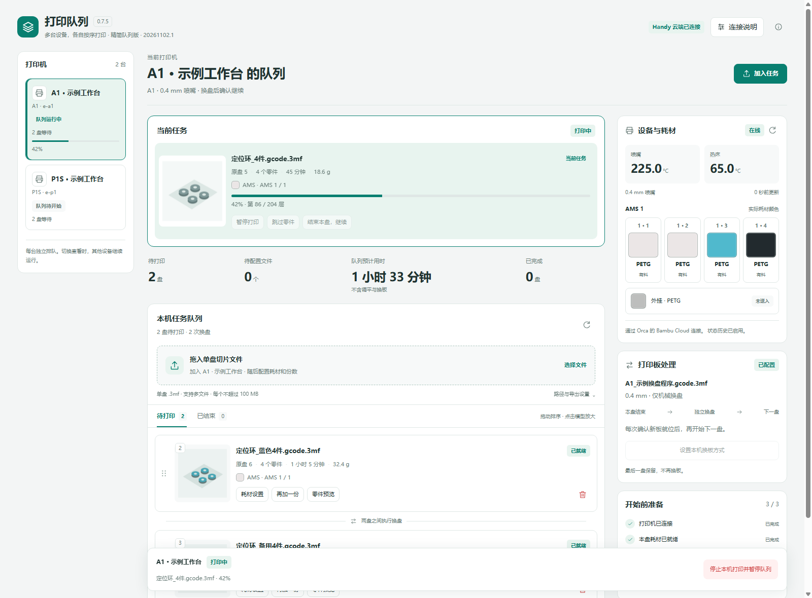
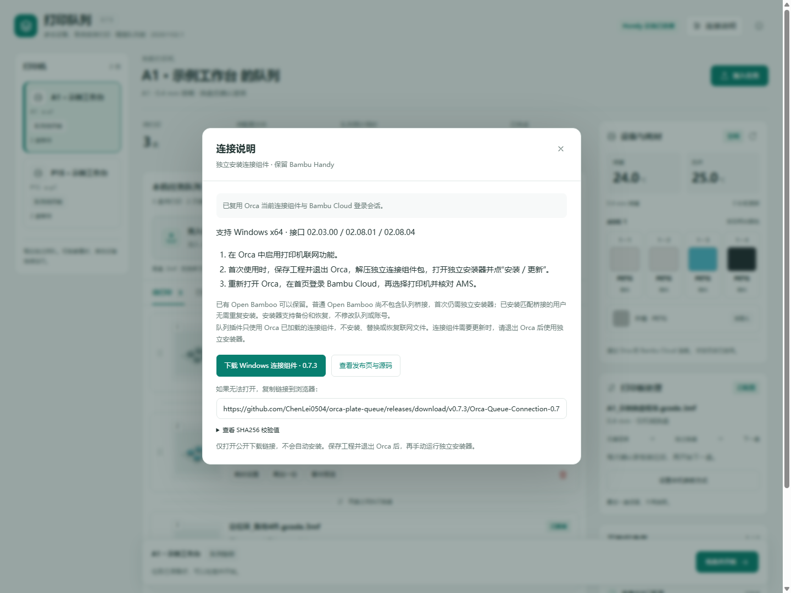
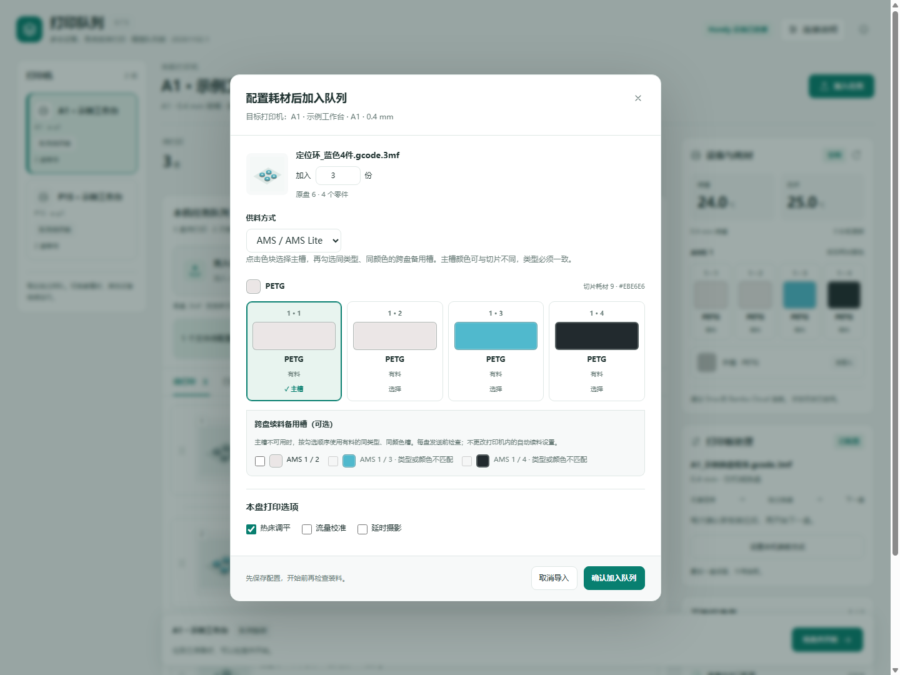
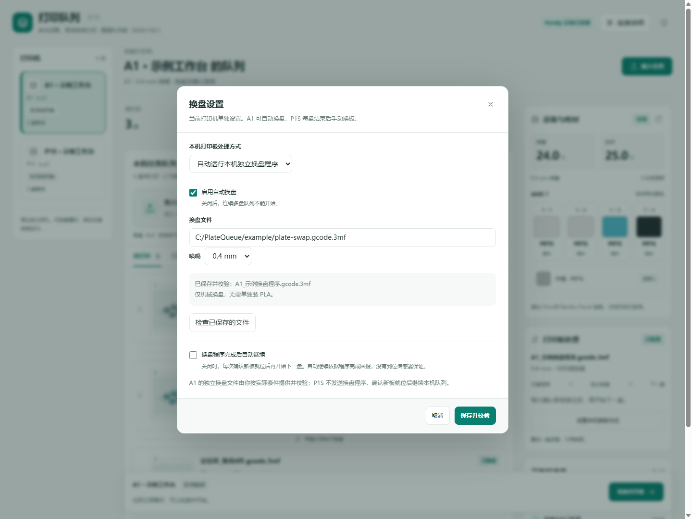
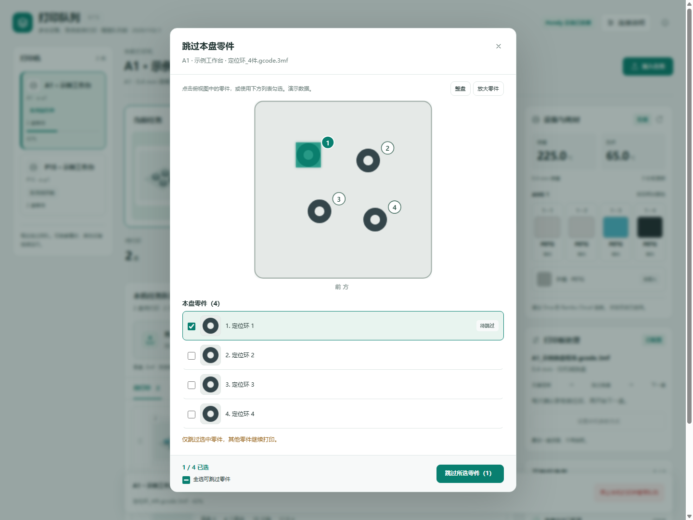

<p align="center">
  
</p>

# Orca Plate Queue

**多台打印机，各自按序打印。 / Independent print queues for your Bambu Lab printers.**

为 OrcaSlicer 提供 A1 / P1S 打印队列、逐盘耗材配置、零件跳过，以及 A1 换盘套件联动，同时保留 Bambu Handy 云端连接。

An OrcaSlicer plugin for A1 / P1S queues, per-plate filament mapping, object skipping and A1 plate-changer workflows, while keeping Bambu Handy connected.

**[中文说明](#zh-cn) · [English](#english) · [Downloads / 下载](https://github.com/ChenLei0504/orca-plate-queue/releases) · [Issues / 问题反馈](https://github.com/ChenLei0504/orca-plate-queue/issues)**

| Component / 组件 | Current source version / 当前源码版本 |
| --- | --- |
| Queue plugin / 队列插件 | **0.7.5** · build **20261102.1** |
| Connection component / 独立连接组件 | **0.7.3** |
| Platform / 平台 | Windows x64 · OrcaSlicer **2.5.0 beta** |

> 公开测试阶段。上表是仓库源码版本，下载以 Releases 中实际发布的附件为准。电脑和 Orca 必须持续运行；队列在本机执行。
>
> Public testing. The table identifies the source version; download the artifacts actually available under Releases. Queues run locally and require the computer and Orca to stay running.



*截图使用当前真实页面和合成演示数据，不包含真实账号、设备编号或打印记录。界面目前为中文，下文提供完整英文使用说明。 / Screenshots show the actual current UI with synthetic demo data, not real accounts, printer IDs or print records. The UI is currently in Chinese; English usage instructions are included below.*

<a id="zh-cn"></a>

## 中文说明

### 这是什么？

Orca Plate Queue 将多个**单盘切片 3MF**排成队列，每台打印机独立保存任务、耗材映射和换板方式。任务按盘发送，保留原始切片文件和零件标记，不通过合盘实现连续打印。

它分成两个部分：**队列插件**负责页面和任务调度；**独立连接组件**让队列复用 Orca 已建立的联网会话。连接组件只在首次安装或需要更新时单独运行。

### 功能一览

| 功能 | 可以做什么 |
| --- | --- |
| 多机队列 | A1、P1S 各自排队和运行；切换查看另一台机器不停止当前队列。 |
| 导入与份数 | 拖入或选择单盘 `.gcode.3mf` / `.3mf`，先配置耗材、加入份数，再确认入队。 |
| 任务卡片 | 模型缩略图、点击放大、拖动排序、再加一份、直接删除等待任务。 |
| 耗材映射 | 每盘选择 AMS / AMS Lite 或外挂；槽位显示实际颜色、类型和在位状态。 |
| 跨盘备用槽 | 主槽不可用时，下盘发送前检查已选备用槽，选择有料且类型、颜色匹配的槽位。 |
| 零件跳过 | 通过俯视预览或下方列表选择零件，保留其他零件继续打印。 |
| A1 换盘 | 指定与套件匹配的独立换盘 3MF；可逐盘确认，也可显式开启程序完成后自动继续。 |
| P1S 换板 | 每盘结束等待人工换板并确认，然后继续下一盘。 |
| 中断与恢复 | 断线、重启、外部停止或任务身份不明时暂停调度，提供核对恢复流程。 |
| Handy | 继续使用原 Bambu Cloud / Bambu Handy 会话查看和操作打印机。 |

### 支持范围

| 项目 | 当前范围 |
| --- | --- |
| 系统 | Windows x64；本地验证宿主为 Windows 11。Windows 10 整机环境仍待实机复验。 |
| OrcaSlicer | 已验证版本为 2.5.0 beta；需要支持插件。 |
| 打印机 | A1、P1S，可连接多台同型号机器。其他机型未列为本版支持范围。 |
| 联网接口 | `02.03.00` / `02.08.01` / `02.08.04` 的已审阅桥接。 |
| 供料 | A1 的 AMS Lite、P1S 的 AMS，以及外挂耗材。 |
| A1 换盘硬件 | 用户自备兼容套件和正确的换盘文件；本项目不提供套件或套件文件。 |

这不是云端托管打印服务，也不是手机端队列管理器。Handy 可以远程操作打印机；队列配置和执行仍在电脑上的 Orca 中。

### 下载与首次安装

打开 **[Releases 下载页面](https://github.com/ChenLei0504/orca-plate-queue/releases)**。

| 文件 | 用途 |
| --- | --- |
| `Orca_Plate_Queue_win_x86_64.whl` | 在 Orca 插件窗口安装的队列插件，**不要使用 pip 安装**。 |
| `Orca-Queue-Connection-0.7.3-Windows-x64.zip` | 独立连接组件，首次使用需要安装。 |
| `source-<版本>.zip` | 对应版本的完整工程源码及构建、测试脚本。 |
| `SHA256SUMS.txt` | 发布附件的 SHA256 校验值。 |

连接组件可从 **[0.7.3 发布页](https://github.com/ChenLei0504/orca-plate-queue/releases/tag/v0.7.3)** 获取，也可使用 **[固定下载链接](https://github.com/ChenLei0504/orca-plate-queue/releases/download/v0.7.3/Orca-Queue-Connection-0.7.3-Windows-x64.zip)**。队列版本与连接组件版本独立，数字不同是正常的。

1. 在 Orca 中打开 **文件 → 插件**，使用“安装插件”选择 `.whl`，并激活队列插件。若使用已发布的 Orca Cloud 订阅版，则在同一 Orca Cloud 账号下刷新并激活。
2. 确认 Orca 已启用打印机联网功能。保存工程，**完整退出 Orca**。
3. 将独立连接 ZIP **完整解压**，打开 `OrcaQueueConnectionSetup.exe`。先点“检查”，核对 Orca 数据目录，再点“安装 / 更新”。便携版请选实际使用的数据目录。
4. 重新打开 Orca，在首页登录 **Bambu Cloud**，确认原“设备”页能正常连接打印机。
5. 打开“打印队列”，选择打印机，核对温度、AMS / 外挂状态，再导入任务。

**两个账号用途不同：** Orca Cloud 用于插件市场和订阅；Bambu Cloud 用于打印机连接。只登录 Orca Cloud 不会让队列看到打印机。

已有 Open Bamboo 用户可保留原插件。**普通 Open Bamboo 不包含本项目的队列桥接**，首次仍需安装独立连接组件。已安装匹配 0.7.3 桥接的用户无需重复安装。

独立工具无需另装 Python 或 PowerShell；安装时会备份并替换清单中的联网文件。工具尚未进行商业代码签名；遇到系统策略拦截时应审核来源和校验值，不要关闭系统防护。详见[连接组件安装说明](连接组件安装说明.txt)。

<details>
<summary>查看连接说明页面 / Connection guide screenshot</summary>



</details>

### 第一次加入打印任务

1. 在 Orca 中选择目标打印机和正确喷嘴，切片后导出**单盘切片 3MF**。普通未切片工程和多盘合并文件不用于此队列流程。
2. 在左侧选定对应打印机，把文件拖入队列页面，或点击“选择文件”。支持多文件，每个文件不超过 100 MB。
3. 在弹出的配置窗口设置**加入份数、供料方式、每种切片耗材对应的实际槽位**，再点“确认加入队列”。配置前的文件不会直接成为可打印任务。
4. 设置本机换板方式：A1 可配置自动换盘文件，或使用手动换板；P1S 使用手动换板。
5. 点击“检查并开始”，核对设备空闲、无阻断告警、耗材就绪、空板及机构状态，再确认开始。

每份对应一盘独立任务。等待任务可以拖动排序、复制或删除；当前执行任务不会被当作普通等待任务删除。



### AMS、外挂与跨盘续料

- **AMS / AMS Lite：**为每种切片耗材选择实际槽位。显示有料、空槽或状态待确认；发送前会再次检查。
- **外挂：**选择外挂供料。设备未报告在位状态时，可按页面提示人工确认；明确的无料状态不能被人工勾选覆盖。
- **跨盘备用槽：**先选择主槽，再勾选备用槽。备用槽需与登记的实际类型、颜色匹配；不会任意改用未选槽位。

例如：主槽为 1、备用为 2，本盘由打印机内部从 1 续料到 2；下盘发送前若检测到 1 已空、2 有料且匹配，就会将下盘映射到 2。

本功能负责**盘与盘之间的选择**，不会替代或设置打印机内部的 AMS 自动续料。品牌和温度参数尚未逐项核对，备用材料应适用于同一切片参数。

### A1 换盘与 P1S 换板

| 模式 | 当前盘结束后 |
| --- | --- |
| A1 自动换盘 | 运行已指定并校验的独立换盘 3MF；默认确认新板就位后继续，可显式开启程序完成后自动继续。 |
| A1 手动换板 | 等待人工更换或清理打印板并确认。 |
| P1S 手动换板 | 等待人工更换或清理打印板并确认；不发送 A1 换盘程序。 |
| 队列最后一盘 | 保留当前打印板，不再执行盘间换盘。 |


请使用与硬件、喷嘴和实际机构匹配的完整换盘文件。软件的“程序完成”不等于机械上新板必然到位；本项目没有已验证的到位传感器保证。

<details>
<summary>查看 A1 换盘设置 / A1 plate-change settings</summary>



</details>

### 零件跳过、结束本盘和停止队列

正在打印多零件文件时，可在“跳过本盘零件”中点击俯视图，或勾选下方列表；两者同步选择，确认后才发送。



| 操作 | 结果 |
| --- | --- |
| 跳过部分零件 | 剩余零件继续打印。多零件跳过需要切片文件包含原生零件标签。 |
| 跳过全部剩余零件／结束本盘并继续 | 结束当前盘，再按本机换板方式继续队列。单零件文件使用“结束本盘”。 |
| 停止打印并暂停队列 | 停止对应机器的当前任务并暂停后续调度。 |
| Handy／屏幕外部停止 | 暂停该机器队列，不自动当作成功完成后换盘。 |

断线、重启、任务身份不明或完成证据不足时，会进入核对流程。**100% 进度本身不作为成功完成依据**；系统也不会自动重发结果不明的任务。

### 更新与常见问题

更新到 0.7.5 后，应看到版本 **0.7.5**、构建 **20261102.1**。ⓘ → 更新状态中可查看页面、队列服务、状态历史和 AMS 映射状态。更新插件后完整退出并重新打开 Orca，避免旧代码仍驻留内存。

| 现象 | 检查方式 |
| --- | --- |
| Orca 能连接，但队列没有打印机 | 核对是否安装独立队列桥接、目标数据目录是否正确，以及是否完整重启；普通 Open Bamboo 或仅刷新页面不等于桥接已启用。 |
| 0.7.4 报“原生设备桥接返回无效信息”或 TypeError | 更新到 0.7.5 并完整重启。此版本修复 Windows Python 3.12+ 的已加载句柄绑定问题。 |
| 显示“绑定失败” | 查看具体错误；核对队列插件版本、连接组件与已加载接口。已正确安装的组件无需反复重装。 |
| 选择 AMS 却提示手动进料 | 核对本盘供料方式、实际槽位和“完整 AMS 映射已启用”状态；出现异常先暂停检查，不把提示视为正常。 |
| 文件准备好了但不能开始 | 打开开始前检查，查看设备状态、HMS / 打印错误、喷嘴、耗材映射与换板配置。 |
| 打印完成却等待核对 | 核对 Handy / 屏幕中的实际任务和状态，再按恢复区域提示处理；不要重复发送原任务。 |
| 路径编码错误 `-7` | 上游 SDK 无法用系统代码页表示当前缓存路径；检查数据目录字符和系统区域环境。 |
| 更新后看不到原队列 | 本地插件与云订阅可能使用不同私有目录；本版不自动合并，避免同时激活两套队列。 |

### 数据、权限与验证范围

队列、缓存和报告保存在 Orca 提供的插件私有目录。用户选择的原始 3MF 仅读取；任务发送使用插件缓存副本。

队列 wheel 不包含 DLL、安装器或命令执行代码，不读取账号文件、不另建登录实例。它仍调用 Orca 已加载的原生桥接，因此市场的原生代码能力提示仍有实际依据。独立安装器的文件修改、备份与恢复范围见其说明。

0.7.5 已在 Orca 自带 Python 3.12.13 与 Python 3.13.1 下各通过 **280 项**测试，页面通过 **69 项**交互测试。测试替身和离线截图不等于实机验收；Windows 10、连续打印、AMS 耗尽续料、零件跳过和机械换盘仍需看守验证。详见[兼容性检查](兼容性检查.txt)及[公开测试清单](公开测试清单.txt)。

### 开发、反馈与授权

运行源码测试不需要连接打印机：

```powershell
python -X utf8 -m unittest discover -q
python -X utf8 -m unittest ci.test_publish_orcacloud -q
npm ci --prefix .ui-test-tools --ignore-scripts
node test_page.cjs
```

没有本地发布包时，发布包专用测试会跳过；完整打包需要已审阅的上游 wheel、匹配的原生构建输入和固定连接 ZIP。不要把安装目录的任意 DLL 当作构建输入。构建说明见 [BUILD.txt](BUILD.txt)，GitHub 自动发布见[配置说明](GitHub自动发布说明.txt)和 [Orca Cloud 官方文档](https://cloud.orcaslicer.com/wiki/#publish-from-github)。

截图可复现：`node docs/render_screenshots.cjs`，再运行 `python docs/capture_screenshots.py`；需要本地 Chrome，全部使用演示数据。

通过 [Issues](https://github.com/ChenLei0504/orca-plate-queue/issues) 反馈时，请提供插件版本与构建号、Orca / Windows 版本、机型、接口版本、复现步骤和脱敏截图。请移除访问码、令牌、账号、设备 ID 和私有路径。

本项目按 **[AGPL-3.0-or-later](LICENSE)** 提供。连接组件基于 [Open Bamboo Networking](https://github.com/persano/open-bamboo-networking/tree/b14f880) 与本项目桥接修改，保留原始 [NOTICE](NOTICE) 和许可；独立连接 ZIP 内含其对应源码。独立社区项目，与 Bambu Lab、OrcaSlicer 官方无隶属或背书关系。

---

<a id="english"></a>

## English

### What is Orca Plate Queue?

Orca Plate Queue manages **independent queues for A1 and P1S printers** inside OrcaSlicer. Each printer keeps its own jobs, filament mappings and plate-handling settings. Jobs are sent as original, individually sliced plates; continuous printing does not rely on merging multiple plates into one file.

The project has two components: the **queue plugin**, which provides the UI and scheduling, and a **standalone connection component**, which lets the queue reuse Orca's existing networking session. The connection installer is needed only for initial installation or a connection-component update.

### Features

| Feature | Behavior |
| --- | --- |
| Multiple printers | Independent A1 / P1S queues; switching the visible printer does not stop other queues. |
| Import and copies | Drag in single-plate sliced 3MF files; configure filament and copy count before confirming import. |
| Job cards | Model thumbnails, enlarged previews, drag-to-reorder, duplicate and direct deletion of waiting jobs. |
| Filament mapping | Per-plate AMS / AMS Lite or external-spool selection, with visible colors and presence status. |
| Backup slots between plates | Recheck selected backup slots before the next plate if the primary is unavailable. |
| Object skipping | Select objects in the top-down preview or synchronized list, then confirm. |
| A1 plate changing | Run a user-supplied plate-change 3MF; confirm each new plate or explicitly enable automatic continuation. |
| P1S plate handling | Wait for manual plate replacement and confirmation between plates. |
| Recovery | Pause scheduling when disconnected, restarted, externally stopped or unable to identify the current task. |
| Bambu Handy | Keep the existing Bambu Cloud / Handy session available. |

The screenshots above and in the Chinese section show the actual UI with synthetic examples: [overview](docs/images/overview.png), [filament settings](docs/images/materials.png), [object skipping](docs/images/objects.png), [A1 swap settings](docs/images/swap.png), and [connection guide](docs/images/connection.png). The application UI is currently in Chinese.

### Requirements and scope

- **Windows x64** and a plugin-capable **OrcaSlicer 2.5.0 beta** build. The local validation host is Windows 11; a full Windows 10 installation still needs verification on a real Windows 10 machine.
- **Bambu Lab A1 or P1S**, including multiple printers of the same model. Other models are outside the current supported scope.
- A reviewed connection bridge for SDK interface **02.03.00 / 02.08.01 / 02.08.04**.
- AMS Lite on A1, AMS on P1S, or an external spool.
- For automatic A1 changing: compatible hardware and a correct, complete swap 3MF supplied by the user. Hardware and kit files are not included.

The computer and Orca must remain running. This is not a cloud-hosted scheduler or a phone-based queue manager: Handy controls the printer remotely, while queue configuration and execution stay on the computer.

### Download and installation

Use the **[Releases page](https://github.com/ChenLei0504/orca-plate-queue/releases)**. Source version 0.7.5 does not imply that a corresponding public Release has already been published.

| Artifact | Purpose |
| --- | --- |
| `Orca_Plate_Queue_win_x86_64.whl` | Queue plugin to install through Orca's plugin manager. **Do not install it with pip.** |
| `Orca-Queue-Connection-0.7.3-Windows-x64.zip` | Standalone connection installer for initial setup. |
| `source-<version>.zip` | Corresponding complete project source, build scripts and tests. |
| `SHA256SUMS.txt` | Artifact SHA256 checksums. |

The pinned connection component is available from the **[0.7.3 release](https://github.com/ChenLei0504/orca-plate-queue/releases/tag/v0.7.3)** or its **[direct download](https://github.com/ChenLei0504/orca-plate-queue/releases/download/v0.7.3/Orca-Queue-Connection-0.7.3-Windows-x64.zip)**. Queue and connection versions are independent.

1. In Orca, open **File → Plugins**, install the `.whl` and activate it. For an available Orca Cloud subscription release, refresh and activate it using the same Orca Cloud account.
2. Enable Orca's printer networking feature. Save your projects and **fully exit Orca**.
3. Extract the entire connection ZIP. Open `OrcaQueueConnectionSetup.exe`, click **Check**, verify the Orca data directory, then choose **Install / Update**. Portable installations must select their actual data directory.
4. Restart Orca and sign in to **Bambu Cloud** on its home page. Confirm that Orca's normal device view can connect to the printer.
5. Open the queue page, select the printer, and check temperatures and filament slots before adding jobs.

**Orca Cloud is for the plugin marketplace; Bambu Cloud is for printers.** Signing in only to Orca Cloud will not make printers appear.

Existing Open Bamboo users can keep that plugin. Ordinary Open Bamboo does **not** include this project's queue bridge, so the standalone connection component is still needed initially. Users with the matching 0.7.3 bridge do not need to reinstall it.

The installer backs up and replaces the networking files listed in its manifest. It does not require a separate Python or PowerShell installation. It is unsigned; review its source and checksums and follow your system's security policy instead of disabling protection. See the [connection installer notes](连接组件安装说明.txt).

### Add your first jobs

1. Slice for the target printer and nozzle, then export a **single-plate sliced 3MF**. An unsliced project or merged multi-plate file is not the input for this workflow.
2. Select the printer in the left sidebar. Drag files onto the queue or choose files; each file must be no larger than 100 MB.
3. Set the **copy count, feed source and physical slot for every sliced filament**, then confirm import. Files are staged until configured and confirmed.
4. Configure plate handling: A1 may use a validated swap file or manual replacement; P1S uses manual replacement.
5. Run the preflight check, verify the printer is idle, resolve blocking alerts, check filament and an empty plate, then confirm the start.

Each copy becomes an independent plate job. Waiting jobs can be reordered, duplicated or deleted. The active job is handled through its printing controls rather than ordinary queue deletion.

### Filament sources and backup slots

For **AMS / AMS Lite**, map every sliced filament to an actual slot. For an **external spool**, explicitly select external feeding; a manual confirmation can cover an unknown presence report, but cannot override an explicit empty report.

Optional backup slots are used **between plates**. If slot 1 is selected as primary and slot 2 as backup, and the printer switches from 1 to 2 during the current print, the next plate can map to slot 2 when slot 1 is empty and slot 2 is present and matches the registered material type and color. Unselected slots are not substituted automatically.

This does not configure or replace the printer's own within-print AMS auto-refill feature. Brand and temperature profiles are not fully verified; backup material must be suitable for the same slicing settings.

### Plate changes

| Mode | Between plates |
| --- | --- |
| A1 automatic | Run the validated standalone swap 3MF, then require confirmation or follow the explicitly enabled automatic-continuation setting. |
| A1 manual | Wait for manual plate replacement or clearing and confirmation. |
| P1S manual | Wait for replacement or clearing and confirmation; do not send an A1 swap program. |
| Last queued plate | Leave the final plate in place; no between-job swap is needed. |

Use a complete swap file matching the hardware and nozzle. A successful program report does not prove that a new plate is physically seated; the project has no verified plate-presence sensor guarantee.

### Skip, end or stop

Select objects in the top-down preview or list and confirm before sending a skip command. Partial skipping requires native object labels in the sliced file; existing G-code is not rewritten to add them.

| Action | Result |
| --- | --- |
| Skip some objects | Continue printing the remaining objects. |
| Skip all remaining objects / end this plate and continue | End the plate, then follow that printer's configured plate-handling flow. For a single object, use the end-plate action. |
| Stop printing and pause the queue | Stop the selected printer's current task and pause further scheduling. |
| External stop from Handy or the printer | Pause that printer's queue rather than treating it as a successful print and changing plates. |

Other printers keep their independent queues. Restart, disconnection, unknown task identity or insufficient completion evidence leads to recovery checks. **100% progress alone is not proof of successful completion**, and uncertain jobs are not resent automatically.

### Updates and troubleshooting

After installing 0.7.5, fully exit and restart Orca. The page should show **0.7.5 / 20261102.1**. The information panel checks the page build, running service, loaded state-history capability and AMS mapping separately.

| Symptom | What to check |
| --- | --- |
| Orca connects but the queue lists no printers | Verify the independent queue bridge, the correct Orca data directory and a full restart. Ordinary Open Bamboo or a page refresh alone is insufficient. |
| 0.7.4 shows invalid bridge information or a TypeError | Upgrade to 0.7.5 and restart. It fixes Windows Python 3.12+ binding of an already-loaded module handle. |
| Explicit binding failure | Read the error and verify queue/component/interface versions. Reinstalling an already-correct connection component repeatedly is unnecessary. |
| Manual feeding requested despite AMS selection | Recheck the job's source, slot and complete AMS-mapping capability; pause and investigate unexpected behavior. |
| Preflight blocks the start | Check state freshness, HMS / print errors, nozzle, mappings and plate-handling settings. |
| A finished print waits for verification | Check the actual task in Handy/on the printer, then use recovery controls. Do not resend the original task. |
| Path-encoding error `-7` | The upstream SDK cannot represent the cache path in the system code page; check directory characters and locale settings. |
| A queue appears missing after changing installation type | Local and cloud-installed plugins may have separate private storage. They are not merged automatically; avoid activating both copies. |

### Data, validation and contributing

Queue state, cached copies and reports stay in Orca-provided private plugin storage. Original selected 3MF files are read only. The queue wheel contains readable runtime sources and no DLLs or installer; it reuses the existing native bridge without creating another account session or reading account files. Native-code capability remains real and may appear in marketplace auditing.

Version 0.7.5 passed **280 tests each** under Orca's Python 3.12.13 and Python 3.13.1, plus **69 UI workflow tests**. These are software and simulated-transport checks, not full physical acceptance. Windows 10 installations, continuous printing, AMS depletion/refill, object skipping and mechanical swaps still require supervised real-machine verification. See the [compatibility report](兼容性检查.txt) and [acceptance checklist](公开测试清单.txt).

Run offline tests with:

```powershell
python -X utf8 -m unittest discover -q
python -X utf8 -m unittest ci.test_publish_orcacloud -q
npm ci --prefix .ui-test-tools --ignore-scripts
node test_page.cjs
```

Artifact-specific tests skip when no local release has been built. Packaging requires reviewed upstream artifacts and the pinned connection ZIP, rather than arbitrary DLLs from an installation. See [BUILD.txt](BUILD.txt). GitHub publishing uses [Orca Cloud's official trusted-publishing flow](https://cloud.orcaslicer.com/wiki/#publish-from-github); setup details are in [the repository guide](GitHub自动发布说明.txt).

Reproduce documentation screenshots with `node docs/render_screenshots.cjs` followed by `python docs/capture_screenshots.py`; local Chrome is required and all data is synthetic.

When opening an [issue](https://github.com/ChenLei0504/orca-plate-queue/issues), include the plugin version/build, Orca and Windows versions, printer/interface versions, reproduction steps and sanitized screenshots. Remove access codes, tokens, accounts, printer IDs and private paths.

Licensed under **[AGPL-3.0-or-later](LICENSE)**. The connection component includes [Open Bamboo Networking](https://github.com/persano/open-bamboo-networking/tree/b14f880) and this project's bridge modifications, with original notices and corresponding source in the connection ZIP. Preserve [NOTICE](NOTICE) and the included licenses when redistributing. This is an independent community project with no official endorsement by Bambu Lab or OrcaSlicer.
